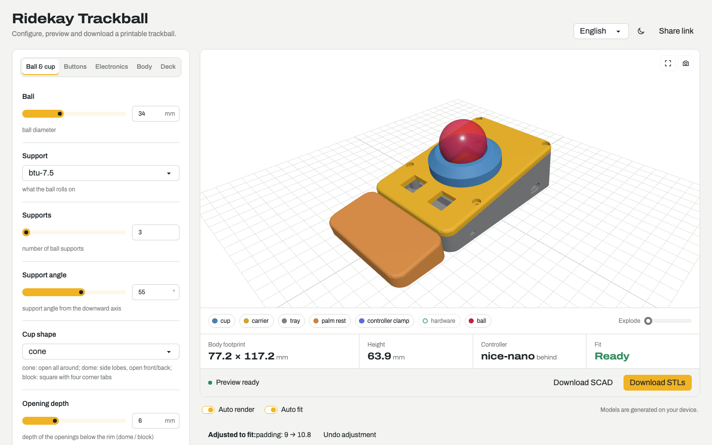

# Ridekay Trackball

**Design a 3D-printable trackball around your own ball, sensor, controller and buttons, right in your browser.**

**[Open the configurator → trackball.ridekay.com](https://trackball.ridekay.com)**

Pick a ball size, how it rolls, a controller, buttons, a battery and a palm rest. The
configurator checks that everything fits, adjusts the body when it has to, and gives you
ready-to-print STL files plus a parts list. Nothing is uploaded: the models are generated
on your own computer.

## Features

- **Live 3D preview** of every printed part, with exploded view, part toggles and PNG
  snapshots.
- **Fit checks with explanations.** Auto fit makes the smallest change that works (for
  example a few millimetres more padding) and tells you what it changed and why.
- **Ball and cup:** 20–60 mm balls; BTUs, ceramic balls or bearing rollers; cone, dome or
  block cups with adjustable openings.
- **Buttons:** Choc, MX or flat microswitch paddles in a row (front, left, right or both
  sides), or large sculpted tiles around the ball.
- **Electronics:** Raspberry Pi Pico family, RP2040-Zero, XIAO, nice!nano, Supermini or Pro
  Micro, with USB-C or Micro-USB openings on any wall. Boards without mounting holes are
  held by a screwed clamp bar.
- **Wireless builds:** a LiPo pocket under the sensor and a power switch (slide, rocker or
  toggle) on the wall of your choice, placed clear of the USB plug and everything inside.
- **Ergonomics:** tilt, tent and a palm rest that is separate, anchored with a key, or fused
  to the base.
- **21 presets** to start from, shareable links, undo/redo, English and Spanish.

## Build your own

### 1. Configure

Open [the configurator](https://trackball.ridekay.com), start from a preset or the
defaults, and adjust. When the status says **Ready**, use **Share link** to keep your
settings and **Download STLs** to get the printable parts. The download also contains your
settings, a dimensions summary and the parts list.

### 2. Buy the parts

The **Parts to buy** list under the preview is generated for your exact design. A typical
build needs:

- a trackball (34 mm by default) and its supports (BTUs, ceramic balls or bearings);
- a PMW3360 sensor board (designed around the
  [Bastard Keyboards](https://github.com/Bastardkb) Charybdis sensor PCB) with its lens;
- a controller board, plus switches and keycaps if you add buttons;
- M3 heat-set inserts (Ø4 × 5 mm), M3 screws, and rubber feet;
- optionally a LiPo battery and a power switch for a wireless controller.

### 3. Print

- Print each part in the orientation it is exported: the cup and lid flat, the base and
  palm rest floor down. Print the controller clamp bar upside down (flat top on the bed).
- PLA or PETG both work. Print the lid in **PETG** if it has flexing paddles or tiles,
  and the palm-rest key in PETG.
- Print a test first: a cup at low curve smoothness checks the press fit of your ball
  supports; a scrap of wall checks the power-switch opening.

### 4. Assemble

1. Press the heat-set inserts: 4 in the cup bottom, 2 in the lid underside, 4 in the base
   posts.
2. Press the BTUs into the cup until the flange seats (or fit the ceramic balls or
   bearings).
3. Screw the sensor board to the lid underside, lens up through the window. Snap key
   switches in from the top, or push microswitches into their holders with a drop of glue.
4. Screw the cup onto the lid (4 screws from below).
5. Mount the controller in the base and wire the sensor (GND, MISO, SCLK, MOSI, NCS, 5V) to
   its SPI pins, with the USB connector through its wall opening. Boards without mounting
   holes: seat the board USB-first, then screw the clamp bar over its far end.
6. Wireless: drop the battery into its frame and fit the power switch (slide it into its
   holder and outward into the wall, snap the rocker in, or fix the toggle with its nut).
7. Put the lid on the base and fix the 4 corner screws. Drop the ball in.

The [geometry, hardware and assembly notes](docs/geometry.md) explain every dimension and
option in detail.

### Firmware

This project designs the hardware only. Any firmware with PMW3360/PMW3389 support over SPI
works, for example [QMK](https://qmk.fm) or [ZMK](https://zmk.dev) with a pointing-device
module; set the pins to match your wiring.

## Status: check before you print

The geometry is tested in software, but some dimensions come from datasheets and community
models rather than measured parts. Measure yours, or print a small test first:

- sensor lens height and ball distance;
- BTU size and press fit;
- D2F microswitch body and plunger;
- the PMW3389 round module (placeholder numbers);
- controller BOOT button positions;
- power-switch openings (SS12D00, KCD11, MTS-102/103);
- the controller clamp's contact area (adjustable under Electronics).

Details are in [Numbers to verify](docs/geometry.md#numbers-to-verify-before-trusting-a-print).
Measurements from real parts are very welcome; see [Contributing](CONTRIBUTING.md).

## Contributing

Bug reports, measurements, print reports and code are all welcome. Start with
[CONTRIBUTING.md](CONTRIBUTING.md); developers will find the setup in
[docs/development.md](docs/development.md) and the code layout in
[docs/architecture.md](docs/architecture.md). Please follow the
[code of conduct](CODE_OF_CONDUCT.md), and report security issues privately as described in
[SECURITY.md](SECURITY.md).

## License

Ridekay Trackball is free software: you can redistribute it and/or modify it under the
terms of the [GNU General Public License](LICENSE), version 3 or (at your option) any later
version. It is distributed WITHOUT ANY WARRANTY; see the license for details.

**The models you generate (SCAD, STL, parts lists) are yours:** print, share and sell them
under any terms you like. The license covers the configurator's source code.

Third-party components keep their own licenses: OpenSCAD (GPL-2.0-or-later), Svelte,
three.js, fflate, daisyUI and Tailwind CSS (MIT), and the Archivo typeface (SIL Open Font
License 1.1). The site lists their notices in
[THIRD_PARTY_LICENSES.txt](https://trackball.ridekay.com/THIRD_PARTY_LICENSES.txt).
